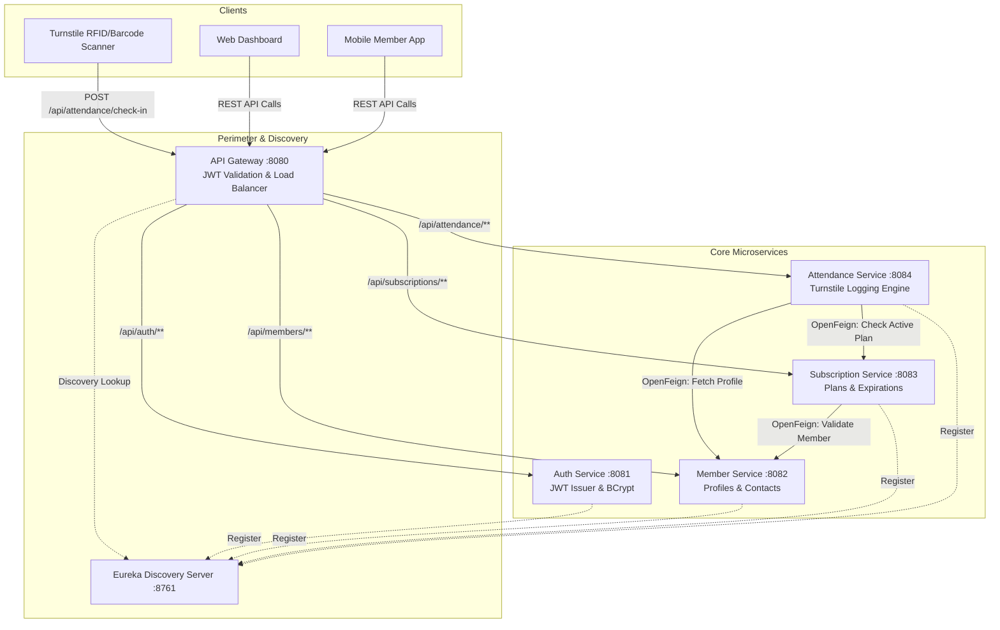
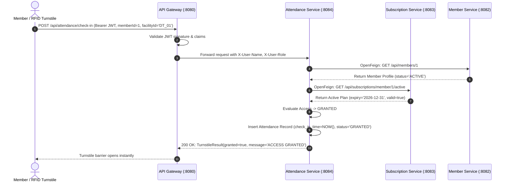

# Software Requirements Specification (SRS)
## Multi-Facility Fitness Membership & Attendance Tracking Platform (PulseFit)

---

### Document Control
- **Project Name:** PulseFIT AI
- **Document Version:** 1.0.0
- **Architectural Style:** Microservices / Service-Oriented Architecture (SOA)
- **Target Runtime:** Java 17, Spring Boot 3.2.x, Spring Cloud 2023.x, Spring Tool Suite 4 (STS4)
- **Evaluation Review:** Review 1

---

## 1. Problem Analysis & Executive Summary

### 1.1 Business Context & Challenges
**PulseFit Health Clubs** is an expanding fitness enterprise managing multiple premier physical fitness facilities across urban centers. With growing foot traffic, the organization faces significant operational bottlenecks at turnstiles and customer service counters during peak workout hours (6:00 AM – 9:00 AM and 5:00 PM – 8:30 PM).

Key challenges identified during field operational audits:
1. **Turnstile Congestion & Bottlenecks:** Delays in verifying subscription validity at physical turnstiles cause entry queues, degrading customer satisfaction and creating physical safety hazards.
2. **Data Fragmentation Across Centers:** Members hold multi-facility passes, but local center systems operate on isolated or lagging databases, leading to double-entry errors or unauthorized access.
3. **Complex Subscription Lifecycles:** Diverse tiers (Basic Single-Facility Monthly, Premium Multi-Facility Quarterly, VIP All-Access Annual) with recurring renewal requirements, grace periods, and expiration dates.
4. **Security & Perimeter Control:** Inadequate tokenization and insecure direct database querying at gate turnstiles exposed member PII (Personally Identifiable Information).

### 1.2 The SOA / Microservices Solution
To overcome these challenges, PulseFit adopts a decoupled, high-throughput Service-Oriented Architecture (SOA) leveraging Spring Boot microservices:
- **Eureka Service Registry:** Enables dynamic registration and load balancing of microservice instances across cluster nodes.
- **Spring Cloud API Gateway:** Central entry point handling perimeter security, routing, and CORS, offloading cross-cutting concerns from individual business services.
- **Auth Service (JWT):** Generates cryptographically signed JSON Web Tokens (HMAC-SHA256) encapsulating member roles and identity, allowing edge-verification without central database bottlenecks.
- **Member Service:** Encapsulates member profile records, contact details, and emergency communication information.
- **Subscription Service:** Manages membership tiers, validity intervals, and automated renewals.
- **Attendance Service:** Provides a high-speed turnstile check-in engine with declarative inter-service communication via Spring Cloud OpenFeign.

---

## 2. System Architecture & Component Interactions



---

## 3. Detailed Functional Requirements

### 3.1 Authentication & Authorization (Auth Service)
- **FR-AUTH-1:** The system shall support user registration with roles: `ROLE_MEMBER`, `ROLE_STAFF`, and `ROLE_ADMIN`.
- **FR-AUTH-2:** Passwords must be hashed using industry-standard BCrypt before persistence.
- **FR-AUTH-3:** On valid credentials, the system shall issue an HMAC-SHA256 signed JWT containing `username`, `email`, `role`, and expiration timestamp (24 hours).
- **FR-AUTH-4:** Provide a stateless token verification endpoint (`/api/auth/validate`).

### 3.2 Member Management (Member Service)
- **FR-MEM-1:** Maintain member profiles with fields: `member_id`, `name`, `contact`, `email`, `address`, `emergency_contact`, `status`, and `created_at`.
- **FR-MEM-2:** Provide CRUD endpoints with search, listing, and updates.
- **FR-MEM-3:** Support administrative deactivation/suspension (`status = INACTIVE`), immediately revoking facility entry privileges.

### 3.3 Subscription Lifecycle Management (Subscription Service)
- **FR-SUB-1:** Maintain subscriptions with fields: `subscription_id`, `member_id`, `plan_type`, `start_date`, `expiry_date`, `status`, `facility_tier`, `price`, `auto_renew`.
- **FR-SUB-2:** Prior to subscription creation, verify member existence and active status in Member Service via OpenFeign.
- **FR-SUB-3:** Support dynamic plan tiers:
  - `BASIC_MONTHLY`: 1 Month validity, Single Facility
  - `PREMIUM_QUARTERLY`: 3 Months validity, Multi-Facility
  - `ALL_ACCESS_ANNUAL`: 12 Months validity, Multi-Facility VIP
- **FR-SUB-4:** Provide instantaneous active subscription query (`/api/subscriptions/member/{id}/active`) returning whether the member holds a currently valid pass.
- **FR-SUB-5:** Provide automated renewal endpoint extending expiry date and re-activating subscription.

### 3.4 Turnstile Attendance & Facility Logging (Attendance Service)
- **FR-ATT-1:** Maintain attendance logs with fields: `attendance_id`, `member_id`, `facility_id`, `facility_name`, `check_in_time`, `check_out_time`, `access_status`, `denial_reason`.
- **FR-ATT-2:** Turnstile Check-In Workflow:
  1. Receive `member_id` and `facility_id` from turnstile scanner.
  2. Invoke `Member Service` to confirm member is registered and `ACTIVE`.
  3. Invoke `Subscription Service` to confirm active non-expired subscription.
  4. If both pass: Record attendance as `GRANTED`, return HTTP 200 with `TurnstileResult(granted=true)`.
  5. If either fails: Record attendance as `DENIED` with specific reason (`MEMBER_INACTIVE`, `NO_ACTIVE_SUBSCRIPTION`), return HTTP 403 with `TurnstileResult(granted=false)`.
- **FR-ATT-3:** Record check-out events (`/api/attendance/check-out`) calculating workout duration.
- **FR-ATT-4:** Provide real-time facility traffic analytics by facility ID and date.

### 3.5 API Gateway & Routing (Spring Cloud Gateway)
- **FR-GW-1:** Route requests using service discovery IDs (`lb://AUTH-SERVICE`, `lb://MEMBER-SERVICE`, `lb://SUBSCRIPTION-SERVICE`, `lb://ATTENDANCE-SERVICE`).
- **FR-GW-2:** Intercept incoming requests with `JwtAuthenticationFilter`, verifying cryptographic token signature.
- **FR-GW-3:** Mutate request headers, injecting verified identity (`X-User-Name`, `X-User-Role`) downstream.
- **FR-GW-4:** Enforce Cross-Origin Resource Sharing (CORS) allowing browser-based single-page applications.

---

## 4. Non-Functional Requirements (NFR)

| Identifier | Category | Specification |
| :--- | :--- | :--- |
| **NFR-01** | Performance & Latency | Turnstile check-in response time must be **< 150 ms** under 1,000 concurrent turnstile requests. |
| **NFR-02** | High Availability | Microservices must register with Eureka discovery to support multi-instance failover and round-robin load balancing. |
| **NFR-03** | Security & Compliance | Stateless JWT tokens; sensitive passwords stored using BCrypt with salt factor 10; role-based access control (RBAC). |
| **NFR-04** | Scalability | Horizontal scaling of Attendance Service instances during peak check-in morning/evening spikes without schema lockups. |
| **NFR-05** | Maintainability & Portability | Built with Java 17, Spring Boot 3, and Spring Tool Suite 4 compatibility with zero external database dependencies (embedded H2 with MySQL-ready configurations). |

---

## 5. Database Schema & Data Models

### 5.1 Member Table
```sql
CREATE TABLE member (
    member_id BIGINT AUTO_INCREMENT PRIMARY KEY,
    name VARCHAR(100) NOT NULL,
    contact VARCHAR(25) NOT NULL,
    email VARCHAR(100) UNIQUE,
    address VARCHAR(255),
    emergency_contact VARCHAR(25),
    status VARCHAR(20) NOT NULL DEFAULT 'ACTIVE',
    created_at TIMESTAMP DEFAULT CURRENT_TIMESTAMP
);
```

### 5.2 Subscription Table
```sql
CREATE TABLE subscription (
    subscription_id BIGINT AUTO_INCREMENT PRIMARY KEY,
    member_id BIGINT NOT NULL,
    plan_type VARCHAR(50) NOT NULL,
    start_date DATE NOT NULL,
    expiry_date DATE NOT NULL,
    status VARCHAR(20) NOT NULL DEFAULT 'ACTIVE',
    facility_tier VARCHAR(30) DEFAULT 'MULTI_FACILITY',
    price DOUBLE,
    auto_renew BOOLEAN DEFAULT FALSE,
    created_at TIMESTAMP DEFAULT CURRENT_TIMESTAMP
);
```

### 5.3 Attendance Table
```sql
CREATE TABLE attendance (
    attendance_id BIGINT AUTO_INCREMENT PRIMARY KEY,
    member_id BIGINT NOT NULL,
    check_in_time TIMESTAMP NOT NULL,
    check_out_time TIMESTAMP,
    facility_id VARCHAR(50) NOT NULL,
    facility_name VARCHAR(100),
    access_status VARCHAR(20) NOT NULL, -- GRANTED, DENIED
    denial_reason VARCHAR(255)
);
```

### 5.4 Users Table (Auth Service)
```sql
CREATE TABLE users (
    id BIGINT AUTO_INCREMENT PRIMARY KEY,
    username VARCHAR(60) NOT NULL UNIQUE,
    password VARCHAR(255) NOT NULL,
    email VARCHAR(100) NOT NULL,
    role VARCHAR(30) NOT NULL,
    created_at TIMESTAMP DEFAULT CURRENT_TIMESTAMP
);
```

---

## 6. Use Cases & Inter-Service Sequence

### Use Case: Member Facility Check-In via Turnstile

