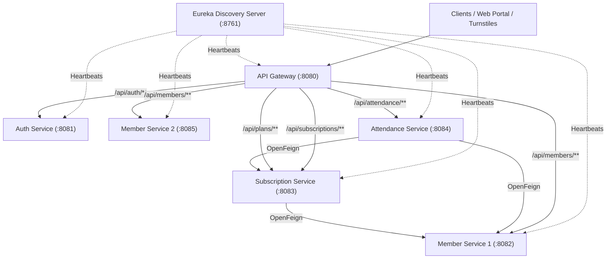
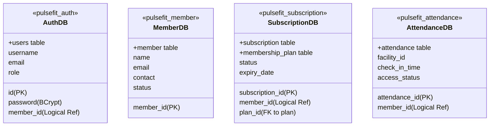
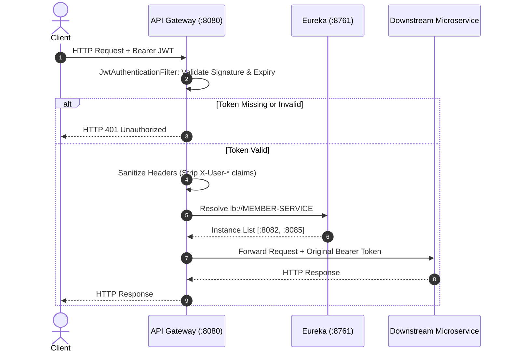
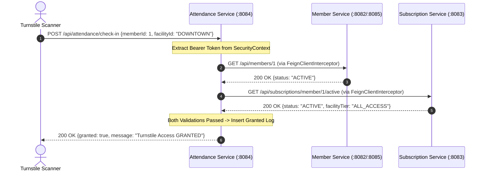
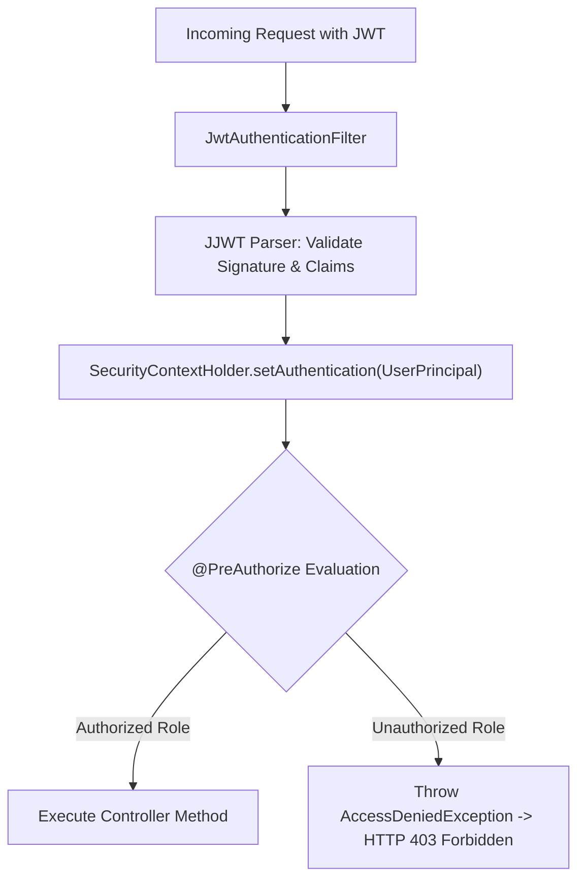
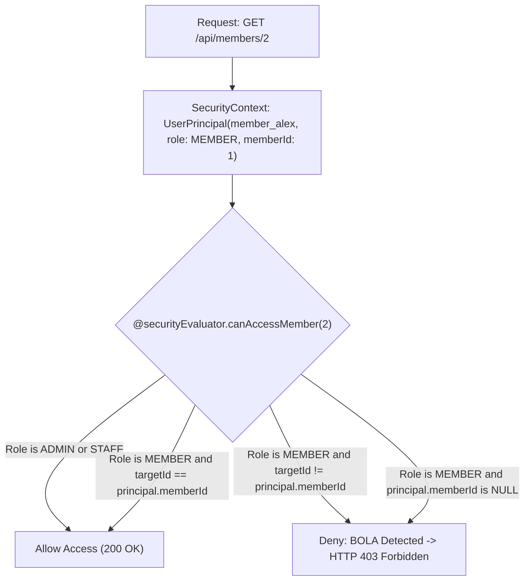
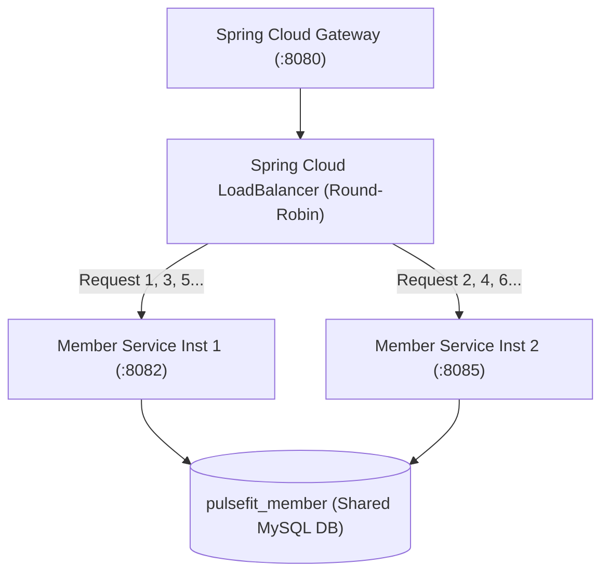

# PulseFIT AI — Microservices Architecture & Security Whitepaper

**System:** PulseFIT AI Multi-Facility Platform  
**Target Review:** University Review-2 Evaluation  
**Author:** Senior Microservices & Application Security Architect  
**Codebase:** `E:\PulseFIT-AI`  

---

## Table of Contents

1. [Architectural Overview & Domain Boundaries](#1-architectural-overview--domain-boundaries)
2. [Database-per-Service Architecture](#2-database-per-service-architecture)
3. [Service Discovery & Health Monitoring (Eureka)](#3-service-discovery--health-monitoring-eureka)
4. [Edge Routing & Gateway Architecture](#4-edge-routing--gateway-architecture)
5. [Inter-Service Communication & OpenFeign](#5-inter-service-communication--openfeign)
6. [JWT Authentication & Zero-Trust Architecture](#6-jwt-authentication--zero-trust-architecture)
7. [Role-Based Access Control (RBAC)](#7-role-based-access-control-rbac)
8. [Object-Level Authorization (BOLA/IDOR) Remediation](#8-object-level-authorization-bolaidor-remediation)
9. [Runtime Load Balancing & High Availability](#9-runtime-load-balancing--high-availability)

---

## 1. Architectural Overview & Domain Boundaries

PulseFIT AI is engineered following **Domain-Driven Design (DDD)** principles to resolve operational bottlenecks encountered in physical multi-facility fitness chains.



### Bounded Contexts
1. **Identity & Security Context (`auth-service`):** Credential lifecycle, BCrypt hashing, JWT issuance, signed claim generation, and role governance (`ROLE_ADMIN`, `ROLE_STAFF`, `ROLE_MEMBER`).
2. **Member Context (`member-service`):** Member demographics, contact info, emergency contacts, physical gym status (`ACTIVE`, `INACTIVE`, `SUSPENDED`).
3. **Billing & Entitlements Context (`subscription-service`):** Plan templates (`BASIC`, `PREMIUM`, `ALL_ACCESS`), duration logic, automated renewals, cancellation.
4. **Physical Access Control Context (`attendance-service`):** Turnstile scan ingestion, multi-service validity orchestration, grant/deny decision logic, and AI anomaly detection.

---

## 2. Database-per-Service Architecture

Each microservice manages its own dedicated MySQL 8.0 database schema, ensuring strong fault isolation, independent scalability, and zero database-level coupling.



### Data Consistency & Isolation Rules
- **No Cross-Database Foreign Keys:** Foreign keys exist only within a single microservice's database.
- **Logical References:** Tables reference entities in other services via primitive IDs (e.g., `member_id BIGINT`).
- **Runtime Integrity Verification:** When creating a subscription or checking in a member, services invoke synchronous OpenFeign REST clients to verify entity existence and status, rather than joining database tables.

---

## 3. Service Discovery & Health Monitoring (Eureka)

Service discovery is powered by **Netflix Eureka Server** on port `8761`.

### Key Configurations
- **Renewal Interval:** Downstream services send heartbeats every 5 to 30 seconds (`eureka.instance.lease-renewal-interval-in-seconds`).
- **Dynamic Port Registration:** Unique instance IDs formatted as `${spring.application.name}:${server.port}` prevent registry collisions when running multiple instances on the same host.
- **Client Cache:** Spring Cloud LoadBalancer caches instance metadata locally with a 2-second TTL to balance fast lookup performance against rapid failover detection.

---

## 4. Edge Routing & Gateway Architecture

**Spring Cloud Gateway** (`:8080`) serves as the single reverse proxy for all external traffic.



### Security Controls at the Gateway
1. **Edge JWT Validation:** Rejects unauthenticated requests before they consume downstream resources.
2. **Anti-Spoofing Header Sanitization:** Malicious clients cannot bypass security by injecting `X-User-Role: ROLE_ADMIN` in HTTP headers. The gateway strips these headers prior to forwarding.
3. **Global CORS Filter:** Permits controlled cross-origin requests from web frontends while securing pre-flight `OPTIONS` requests.

---

## 5. Inter-Service Communication & OpenFeign

When complex business workflows require cross-domain validation, services communicate synchronously via **Spring Cloud OpenFeign**.



### Feign Token Propagation
To ensure zero-trust compliance, inter-service Feign calls do not bypass security filters. A custom `FeignClientInterceptor` intercepts outgoing Feign requests and attaches the caller's active Bearer token:

```java
@Configuration
public class FeignClientInterceptor implements RequestInterceptor {
    @Override
    public void apply(RequestTemplate template) {
        ServletRequestAttributes attributes = (ServletRequestAttributes) RequestContextHolder.getRequestAttributes();
        if (attributes != null) {
            String authHeader = attributes.getRequest().getHeader(HttpHeaders.AUTHORIZATION);
            if (authHeader != null && !authHeader.isBlank()) {
                template.header(HttpHeaders.AUTHORIZATION, authHeader);
            }
        }
    }
}
```

---

## 6. JWT Authentication & Zero-Trust Architecture

PulseFIT AI enforces a **Zero-Trust Security Architecture**. Authentication is enforced twice:
1. **At the Edge:** API Gateway validates JWT tokens to protect network bandwidth.
2. **At the Downstream Microservice:** Every business service independently parses and validates the JWT signature using JJWT 0.11.5, protecting internal services against rogue internal calls.

### Token Structure (JJWT 0.11.5)
```json
{
  "alg": "HS256",
  "typ": "JWT"
}
.
{
  "sub": "member_alex",
  "role": "ROLE_MEMBER",
  "memberId": 1,
  "iat": 1793557378,
  "exp": 1793643778
}
.
[HMAC-SHA256 Signature using shared secret]
```

---

## 7. Role-Based Access Control (RBAC)

Authorization is implemented declaratively via Spring Security's `@PreAuthorize` on controller endpoints.



### Policy Rules
- **Admin Only (`hasRole('ADMIN')`):** Delete member, list auth users.
- **Admin or Staff (`hasAnyRole('ADMIN', 'STAFF')`):** Create/update member profiles, create/delete plan templates, cancel/delete subscriptions, inspect turnstile fraud alerts.
- **Member Access:** Permitted read access to general catalogs (`/api/plans`, `/api/members`), but restricted to own data for personal records.

---

## 8. Object-Level Authorization (BOLA/IDOR) Remediation

In Milestone 5A, we resolved Broken Object Level Authorization (BOLA) by binding verified identities to signed tokens.



### SecurityEvaluator Implementation
```java
@Component("securityEvaluator")
public class SecurityEvaluator {

    public boolean canAccessMember(Long targetMemberId) {
        Authentication auth = SecurityContextHolder.getContext().getAuthentication();
        if (auth == null || !auth.isAuthenticated()) {
            return false;
        }

        // 1. ADMIN and STAFF have legitimate administrative access
        if (auth.getAuthorities().stream().anyMatch(a -> 
            a.getAuthority().equals("ROLE_ADMIN") || a.getAuthority().equals("ROLE_STAFF"))) {
            return true;
        }

        // 2. MEMBER must possess a verified memberId claim matching the target record
        if (auth.getPrincipal() instanceof UserPrincipal principal) {
            Long authenticatedMemberId = principal.getMemberId();
            if (authenticatedMemberId == null) {
                return false; // Reject unmapped member tokens
            }
            return authenticatedMemberId.equals(targetMemberId);
        }

        return false;
    }
}
```

---

## 9. Runtime Load Balancing & High Availability

To handle peak turnstile scan volumes, `member-service` runs two active instances:
- **Instance 1:** `member-service:8082`
- **Instance 2:** `member-service:8085`



### Port Tracing Filter
Each Member Service instance includes a servlet filter that attaches `X-Handled-By-Port: <port>` to all HTTP responses. This enables real-time verification of load distribution and failover behavior.
